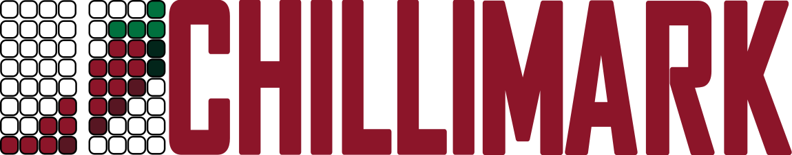
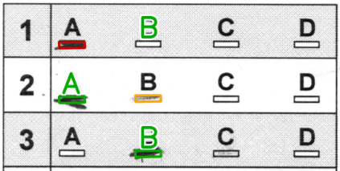
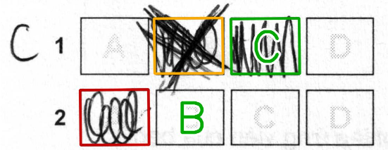
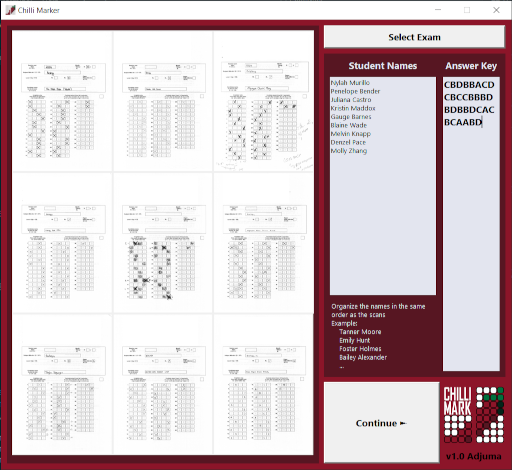
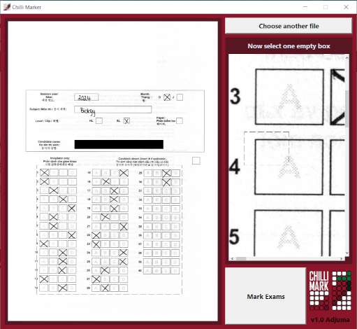
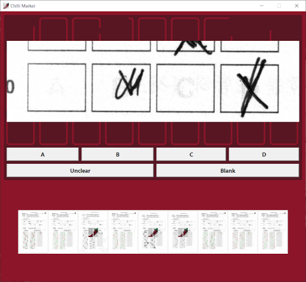

# ChilliMark — v2.4 Birdseye

The v2.4 web release includes SIMD marking, bounded PDF preparation, background
PDF/ZIP generation and printable class reports. See
[PDF preparation and reports](docs/pdf-preparation-and-reports.md) for behaviour
and validation, and [Version 3: Cayenne](docs/cayenne-roadmap.md) for planned
teacher quality-of-life work.


ChilliMark Heuristical Identification of Landmark-Less Input Multiple-choice Answer Recognition Kernel

ChilliMark is able to mark some multiple choice sheets without the use of QR code or other landmarks and predefined templates 

It was developed against the multiple choice sheets for the IBDP and IGCSE exams boards. Specifically it was developed for the science version of the multiple choice sheets.

It was designed to match the work flow of teachers who should have ready access to auto-feed scanners. Note: Due to this is does not do any deskewing, only rotation and scaling.

## Birdseye browser workflow

Load PDF, PNG or JPEG scans, then check the names and answer key. The upload
area collapses after loading and Continue stays visible at the bottom. Names
are optional: blank names produce Student 01, Student 02, and so on. If names
are supplied, enter exactly one per page. Removing a page removes its matching
name when the counts agree. Real uploads never insert the sample names.
Samples include 27 IGCSE or 30 IBDP answers.

For phone photos, choose Camera Scan for one sheet or Batch Scan for a
stack. Batch Scan keeps the camera open between captures. Finish Scanning
opens review with previews, retakes, removal and rotation; Confirm batch adds
the pages to the normal collection before calibration or marking. Auto Scan
adds hands-free capture: hold one upright sheet still, wait for capture, then
remove it completely before introducing the next. Pause/Resume and manual
Capture are available; do not leave a stack in view. See
[Camera scanning notes](docs/camera-scanning.md) for device requirements.

Calibration supports mouse, finger and pen. Use Draw to frame the answer grid,
review it, then choose Next: Select Box. Use Pan to move a zoomed page and the
zoom buttons/Fit to change its display scale. Draw around one clean empty box,
wait for Empty box ready, then choose Mark Exams. These controls change display
and selection only; MCQ detection and grading are unchanged.

Review includes multiple marks and apparent blanks with an answer-key entry,
so light pencil is not silently treated as a final blank. Confirm a genuine
blank with Blank. Unused questions without a key entry are not added for this
check. Click/tap the answer on the snippet or choose its letter,
Blank or Unclear. The choice saves and advances immediately; Previous revisits
a decision. Review starts as completed pages become available while marking
continues. Final results keep input order. When all pages and corrections are ready, choose View
results. Cancel review returns to setup. Snippet zoom helps inspect marks. Results open on Overall statistics. Student scores
and Marked sheets are separate tabs; per-student PNG/print controls are in the
student card, and ZIP/CSV exports are in the results header. Marked sheets appear
before the question breakdown on narrow screens and include zoom/Fit controls.
The in-app Guide describes the same workflow. The desktop screenshots below
are retained as historical documentation.

`npm run test:interface` checks desktop, tablet, phone and landscape layouts,
readiness/name alignment, multi-file selection, dialog focus/scroll behavior,
actual touch/mouse/pen gestures, cancellation/panning, empty-box calibration,
worker marking, review Back/revision, CSV output, and the mobile result flow.
Set `CHROMIUM_PATH` to use a system Chromium. Touch tests use Chromium device
emulation; they do not substitute for testing physical iOS/Android hardware.

## Branding

The web interface uses the original banner and icon assets. Marked sheets include
`icons/printmark.png` at the original registered-page position (x=4271, y=256,
273 × 256 pixels), with the original white print background. The logo is baked
into the image for both first-pass marking and final correction rendering, so
previews, PNG downloads, ZIP archives, and printing share the same watermark.
Raw scans used for detection and correction crops remain free of added branding.

Run `npm run test:branding` to check logo loading, mobile layout, and exact
watermark placement/pixels. `npm run test:grading` also verifies the watermark in
the actual exported PNG while checking score consistency.

## Features

### No template
Use your own worksheets. You do not need to use any special template. It only works with square boxes for now because it was developed against thh IBDP and Cambridge IGCSE papers. It does technically require one large box on the page that it uses to determine rotation and scale.

### Annotations
Generate annotated pages with the student name, test score, Detected responses, and Correct Answer Key.

		

### Output data
Generate a CSV with both each students score and individual question response rates for further processing.

### Clear up ambiguous choices
If two boxes are detected with answers the user can choose the correct questions

## Original desktop workflow
1. Scan your completed exams using 600 DPI. 

2. Load your PDF - Drag and drop is supported


3. Enter Students names and answer key and hit continue 



4. Select the question area and define one empty box. This needs to be quite tightly around the box for the best results. Since this is the box used to detect and understand the image it is worth find the best one free of any scanning artifacts



5. Enter corrections



6. Finished. Review the output for any mistakes. Run again is there are issue. I hope to allow finer corrections in future updates

## Original desktop roadmap
1. Round bubbles
1. Full Manual Mode
1. Resizable Gui
1. Web app
1. Detection realignment
1. Page reordering
1. Multi regions marking
1. JPEG in put
1. Phone and Tablet version
1. IOS Version
1. Appends statistics to a report page

## Known Issues
1. Sometimes the detected boxes do not line up with the real boxes. 
1. Boxes that seem perfectly fine visually are processed differently resulting in errors and rejections.


## Score consistency

Scoring is calculated from finalized responses and the answer key, independently
of annotation drawing. Corrections refresh that score; rendering cannot award
additional points. Final rendering starts from the clean registered scan and
leaves the student record unchanged.

Run `npm run test:grading` with `CHROMIUM_PATH` when using a system Chromium.
The regression uses 27 questions with exactly four correct responses and checks
4/27 in the scorecard, CSV, printed annotation text, and downloaded PNG. It also
checks identical pixels on repeated rendering, immutable student state, and
correct/wrong/blank/unclear correction outcomes. Existing marked images must be
regenerated after updating; previously downloaded files are not rewritten.


## Web port: page geometry

PDFs are rendered at 600 DPI. Only the first-page calibration template is
resized to 4800 × 6840 before rotation. Each student page keeps its own raster
dimensions through rotation, then is scaled and translated using the detected
alignment rectangle into the template's coordinate space. Question areas, box
contours, correction crops, and final annotations use that registered space.
Intermediate scans are stored losslessly as PNGs.

For the browser geometry regression check:

```sh
npm install
npx playwright install chromium
npm run test:geometry
```

To use an existing Chromium installation, set `CHROMIUM_PATH` to its executable.
The check reads both complete sample PDFs, checks every page's native 600-DPI
size, and renders/detects/corrects two full-resolution pages from each sample.
This requires more time and memory than low-resolution previews; it checks the
coordinate pipeline, not recognition accuracy against a manually verified key.

The calibration parity check runs the original Python `Parameters.set_box` and
`find_responses` methods against the same pixels and box centers used in Chromium.
It covers rounded empty boxes, crosses, shading, multiple marks, faint marks,
erasure residue, and the first IB and IGCSE sample pages. Row reconstruction is
shared test input, so its separate port differences do not affect this comparison.

```sh
python3 -m venv .venv
.venv/bin/pip install numpy opencv-python-headless
PYTHON=.venv/bin/python npm run test:calibration
```

`CHROMIUM_PATH` is supported as for the geometry check. Invalid box selections
are rejected instead of being replaced with fabricated contours. The browser
limits contour expansion to 128 attempts and reports failure if it cannot
stabilize; valid selections use the original area-stability rule and threshold.

## Results and exports

Results open on Overall Statistics, with class score summaries, a score
histogram, and question response distributions. Student scores and annotated
sheets remain available in their own tabs.

Class Report CSV includes the answer key, every student's score and per-question
responses, followed by correct/option/blank/unclear counts. Missing responses are
padded as Blank so rows keep the same question columns. Item Stats CSV includes
counts and percentages for every option, including options beyond D. The ZIP
includes both reports alongside the annotated sheets.

Run `npm run test:results` (with `CHROMIUM_PATH` if needed) to check the results
navigation and actual CSV/ZIP downloads. This test uses Python's standard CSV
reader to validate quoted, Unicode, comma-containing, and multiline names.

## Deferred page preparation and exports

Upload reads PDF page metadata without rendering every page. Visible thumbnails
use small rasters (360 pixels on the longest edge); the enlarged preview uses
1400 pixels. Calibration and marking request the original 600-DPI pixels through
a single raster queue, ahead of waiting thumbnails. Manual rotation is applied
when a raster is requested. One full page and at most 24 small previews are
cached. Removing the last page from a document releases its PDF worker and
cached images. Clearing/resetting also revokes owned image URLs.

PNG output uses asynchronous Blob encoding rather than retained base64 strings.
Only ambiguous pages retain a clean registered raster for final correction
rendering, and only corrected students are rendered again after review. ZIP
assembly runs in one disposable worker per export; leaving results cancels it.
OpenCV initializes on demand using the same npm runtime as before. PDF.js
already parses documents in its own worker. MCQ detection, thresholds, row logic,
response reading and scoring are unchanged; marking runs in the background as
described below.

A local Chromium comparison on the 14-page IGCSE sample measured metadata load
at approximately 0.5–1.7 seconds, compared with 24 seconds for the previous eager
load/render/encode path. First full-page preparation took approximately 1.4–2.1
seconds when requested. These are individual local runs, not a cross-device
benchmark or an end-to-end marking speed claim. The old upload retained about
217 million base64 characters; the new upload retains source files and metadata,
then renders small previews. No browser resident-memory peak was measured.

Run `npm run test:loading` (with `CHROMIUM_PATH` if needed). It compares more than
68 million full-resolution pixels against the previous PDF viewport/render
settings, including rotation; checks metadata-only loading, preview/cache bounds,
queue priority, cancellation, URL cleanup, and the actual upload/rotate/remove/
clear workflow. Existing geometry, calibration, grading, branding and export
regressions remain applicable. Rendering/recognition errors halt marking for
review instead of producing a fabricated zero score.


## Background marking and bounded parallelism

Marking and final correction rendering run in dedicated module workers using the
same engine functions and OpenCV version. The canvas boundary supports
OffscreenCanvas; scan pixels, thresholding, grouping, response reading, scoring,
annotation commands and watermark placement keep their existing behavior.

Auto estimates a ceiling from logical processors, reported device memory and
largest native scan size (at most four workers). Missing memory information uses
one worker. It starts with at most two workers. On sufficiently long exams it
warms those workers, measures four pages, then tries one wave at the ceiling.
It keeps the larger pool only if throughput improves by at least 10%; otherwise
it releases the extra workers. These timings include rasterization and worker
startup. The probe uses real pages and streams their results normally. Short
exams skip the probe. Browser hints and a short trial cannot guarantee a global
optimum; page complexity, other apps and thermal throttling affect throughput.
Setup also offers explicit 1, 2 or 4 worker overrides. Each worker owns an
independent OpenCV/WASM heap and large 600-DPI buffers. Twenty pages do not mean
twenty workers: only one input per active worker is prepared at a time.
Calibration alignment and empty-box measurement share one worker per calibration screen. Full PDF rasterization remains
serial, and supplies only the next input for each available marking worker.

Results keep input/student order even when pages finish out of order. Review
prompts arrive as completed pages become available; their history stays stable. Progress counts completed pages and displays each page's actual state.
Cancel marking, navigation, and page failures terminate the pool, including
synchronous native CV work, and discard partial result images. A failed page is
reported rather than assigned an invented score. Workers are released after the
batch; corrected annotations use a disposable worker. The browser needs module
workers, OffscreenCanvas and createImageBitmap; unsupported browsers receive a
clear error instead of silently reverting to interface-blocking marking.

Run `npm run test:workers` with `CHROMIUM_PATH` as needed. It checks exact response
and output-pixel parity for normal/ambiguous/corrected scans, a four-worker pool and actual job
overlap, an interface heartbeat during native processing, stable student order,
worker/URL cleanup on completion/cancellation/failure, hardware caps, and parallel
progress states. `WORKER_TEST_BUILD=1 npm run test:workers` builds and tests the
production worker/chunk URLs as well. `test:geometry` also compares worker versus
main-thread recognition on the first real IB and IGCSE sample pages. Startup and
memory overhead can outweigh parallelism for small batches; this is not a claim
of a fixed speed multiplier on every device.


### Birdseye live-review refinements

Calibration preparation shows an activity spinner and the current stage. A small
animated rectangle demonstrates question-area dragging. Empty-box selection
opens close up; Box view restores that scale and Fit shows the whole crop. Roomy
selections snap to a detected box before the original set_box measurement runs;
no fabricated contours or grading thresholds are used. Blank selections and
multiple boxes without a unique centred target are rejected.

Personal files replace a loaded sample and clear its names and answer key.
Adding more files to an existing personal exam preserves its entered key.
Mark Another Exam starts a fresh setup with empty names/key. ZIP/CSV output is
still generated from finalized responses, after all marking and review finish.


### Desktop page workspace

At widths of 1024 pixels and above, calibration uses a full-height page window
on the left and a bounded controls panel on the right. Instructions, tools and
steps share that panel; Next/Mark Exams stay visible at its bottom. The panel
can scroll on short screens. Smaller viewports retain the stacked touch layout.
Marked sheets use the same page-left/student-controls-right arrangement on
desktop, and Fit shows the entire portrait image. Zoom and Pan retain native
selection coordinates; the marking engine is unchanged.

Run `npm run test:desktop` (with `CHROMIUM_PATH` as needed) for the 1440×900,
1280×720 and 1024×600 desktop layout checks, portrait fit, visible controls,
selection and the marked-sheet layout. `test:interface` covers the smaller
screen/touch workflow.


### Marking throughput and four-worker option

Marking now transfers native ImageBitmaps to workers directly. The PDF render
viewport, 600-DPI dimensions and rotation are unchanged, but marking no longer
PNG-encodes a rendered input only to decode it again in the worker. Encoded PNG
previews/exports retain their existing paths. An already-cached calibration PNG
is decoded once rather than rendering that first page again. Transferred input bitmaps are
closed after decoding, and unused inputs close on cancellation or failure.

Worker canvas output also avoids an extra OpenCV conversion/copy and JavaScript
pixel copy for already-contiguous 8-bit RGBA matrices. Non-contiguous crops and
other channel/depth formats keep the original conversion path. This changes
image transport/storage only: contour detection, deskew, thresholds, row logic,
response reading and grading rules are unchanged.

A profile of the first IGCSE sample page put about 2.44 s in alignment/deskew,
1.48 s in box finding, 1.83 s in input loading and just 0.024 s in response
reading. Native warp/median-blur operations dominate much of the actual CV work;
changing recognition heuristics was outside this optimization.

Local four-page IGCSE comparisons used the same 27-answer all-A key and
600-DPI settings in a container limited to two CPU cores and 8 GiB RAM:

| Workers | Previous pipeline | Bitmap/copy improvements |
| --- | ---: | ---: |
| 2 | 18.9 s | 16.1 s |
| 4 | 22.6 s | 19.2 s |

These are individual local runs, not a cross-device speed guarantee. All 108
responses and four scores agreed before/after in both worker configurations.
Four workers were slower than two here; Auto now measures extra workers on
longer batches rather than assuming they help. One-page look-ahead was also
tested and omitted after it slowed the first result and the batch on this host.
The queue prepares one input per available worker, not an eager batch.

`test:loading` now compares over 136 million pixels across PNG and direct-bitmap
inputs, including rotated pages, and checks that marking performs no input PNG
encoding. `test:workers` covers Blob compatibility, bitmap ownership transfer,
pixel-identical normal/ambiguous/corrected output, the four-worker pool, result
order, streaming, cancellation and resource cleanup. Use `WORKER_TEST_BUILD=1`
for the built worker/chunk regression.

A longer run used 20 pages (the 14 bundled IGCSE scans plus six repeats).
All 540 responses and 20 scores matched with 2, 4 and Auto. This environment
reported three logical processors and 8 GiB; Auto tried three workers and
returned to two after the measured trial was slower. More pages amortize
startup and make a trial useful, but do not make four workers universally faster.
`npm run test:worker-policy` checks hardware/page-size caps and the throughput
threshold. `npm run test:throughput` repeats the 20-page comparison; optionally
set `COUNTS=2,4,auto` and `BENCHMARK_REPORT=/path/report.json` to save its results.

`npm run test:resolution` is a separate diagnostic: four real IGCSE pages are
shrunk to one quarter of their width and height (one sixteenth of the pixels),
then upscaled to their original dimensions and marked with the same rules.
It reports changed answers, scores and failures rather than assuming equal
output. This experiment is not an application setting; normal marking always
uses the existing full-resolution pixels.

The initial four-page resolution trial matched all 108 answers and all four
scores. That small sample does not establish safety for faint marks, erasures
or other scans, so it does not enable downsampling in normal marking.

### Relative box-position consistency

The first marked page records the answer-column identities. If crossing-out leaves fewer
than three visible boxes in a column on a later page, that column can retain
its original A–D slot instead of shifting the following letters. Restoration
requires every reliable detected column to match a distinct calibrated slot;
complete detected grids retain their existing path. This fixes the missing A
column on IBDP sample page 7, questions 29–30.

After normal marking, batches of at least four pages also compare every marked
answer-box position across the exam. Each question block is normalized using
its own column/row spacing and translation. A shifted or scaled page therefore
does not count as a misplaced box. Each slot uses a robust mean across pages;
outlying observations are excluded rather than pulling the class grid toward
a crossed-out page. Corrections require at least three agreeing observations,
and deviations must exceed all three tolerances: 12% of row/column spacing,
a quarter of calibrated box size, and six median absolute deviations. The
spacing floor prevents ordinary scan variation in thin IGCSE boxes being forced.

Only anomalous pages are rasterized and marked again, using the corrected
positions and the existing fill/ambiguity/grading rules. Native scans are not
held for the whole exam and there is no second image pass for healthy pages.
Live review continues during this check. Manual responses are explicitly
recorded and reapplied to replacement results; review history stays in place,
crops refresh, and scores/annotations are rebuilt from the final responses.
Overall statistics reports the pages/answer boxes checked and positions moved.
A new exam, template or question area clears the learned layout. Small batches
still benefit from reference-column anchors but cannot establish a class consensus.

Run `npm run test:geometry-consensus` for relative-position math, translation,
scale, jitter, outliers and divided-class safeguards. `npm run test:columns`
checks all 25 bundled IBDP/IGCSE sample pages, including native worker/final
annotation on IBDP page 7. `npm run test:geometry-repair` exercises selective
native reprocessing, answer/score updates and manual-answer preservation.

### Preview-first calibration and direct review

Question-area selection paints a 1200-pixel preview before preparing the
600-DPI page. Its canvas stays small; pointer positions map to the existing
4800×6840 coordinate frame. The original full-resolution template alignment
runs in a disposable worker while selection remains interactive. Its measured
rotation transfers an early selection by transforming all four corners. An
active drag finishes before the frame changes. Existing aligned selections are
not transformed again when returning to calibration.

The empty-box stage uses the full-resolution aligned image and original box
measurement logic. Next opens the sample-box view immediately from the preview;
the sharper image replaces it when ready. An early box selection retains its
outline and an animated wheel while awaiting detail and measurement. Cropping
the sample-box view is deferred until that stage. Navigation aborts pending raster
work, terminates the calibration worker and releases owned preview/template URLs.
`npm run test:calibration-preview` checks early interaction, coordinate transfer,
full-resolution crop dimensions, all 32,832,000 template pixels and cancellation.
Use `CALIBRATION_TEST_BUILD=1` to exercise built worker/chunk URLs.

Answer review uses the selectable scan regions without a duplicate row of
letter buttons. Tab/Enter and answer-letter shortcuts work alongside touch;
Blank, Unclear and Previous remain available. Once marking, consistency checks
and required review finish, sheets are prepared and results open automatically.
No final View results confirmation is required. A preparation error retains a
retry action instead of repeatedly retrying in the background.


Sample-box display pixels and selection coordinates are independent. The preview
crop uses canonical pointer coordinates, and both the question area and pending
box selection transfer using the native alignment transform after any active
gesture ends. Image upgrades keep the same canvas window and logical coordinate
frame. Measurement uses the retained full-resolution image in the calibration worker,
keeping the selection wheel and interface responsive. Mark Exams waits for a valid
measurement; failures keep the drawn outline and show the reason. Changing stage
or leaving calibration cancels any outstanding measurement.


### Calibration reuse and binary cleanup masks

Empty-box calibration now does only the selected-box measurement. The screen
keeps one worker/OpenCV runtime and one aligned full-resolution Mat from page
preparation, so repeated selections do not restart OpenCV or decode the page
again. Leaving calibration or changing the template disposes the session. An
interrupted native operation terminates its worker; a later retry decodes the
saved aligned PNG once, then resumes reuse. It never retains all exam pages.

Column-layout discovery is deferred to marking. When no reference is supplied,
the first marked page supplies it from its existing box-detection result before
later pages are dispatched. There is no separate reference-grid scan and no
layout scan while accepting the empty box. The remaining pages use the normal
parallel pool; Auto's timed trial starts after establishing the reference.

The constructed erosion/slicing masks now use one 8-bit channel instead of
three identical binary channels. The 31×31 kernel, iteration count, cut lines,
size limits and global coordinates remain unchanged. Scan pixels and answer
interpretation are unchanged. The test-only RGB implementation in
`tests/helpers/legacyCleanup.ts` verifies the detected centres/order on all 25
sample pages, and the IBDP page-7 regression also tests learning the reference
during marking. Bounded contour masks are a further candidate, not part of this
change; their halo/border behaviour needs separate parity testing.

`npm run test:calibration-session` checks reuse, retries, cancellation recovery,
stale messages and disposal. `test:calibration-preview` verifies the real worker
is reused without another image transfer, alongside the existing pixel/gesture
checks. `test:columns` compares binary-mask results to the RGB reference and
checks deferred reference discovery.
